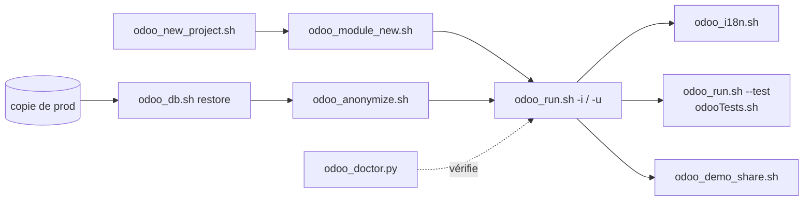

<div align="center">

# 🧰 Scripts

**Petits outils du quotidien pour développer sur Odoo, traiter des documents et garder un Mac en forme.**


[Je veux…](#-je-veux) · [Démarrage](#-démarrage-rapide) · [Odoo](#-odoo) · [Documents](#-documents-et-médias) · [Système](#%EF%B8%8F-système-et-productivité) · [Notes](#-notes)

</div>

---

## 🔎 Je veux…

| Je veux… | Script | Exemple |
|---|---|---|
| démarrer un nouveau projet client Odoo | [`odoo_new_project.sh`](#odoo_new_projectsh) | `odoo_new_project.sh ~/…/Acme/ERP/Odoo 19.0 --init-db --lang fr_FR` |
| lancer Odoo, mettre à jour un module, tester | [`odoo_run.sh`](#odoo_runsh) | `odoo_run.sh --test my_module` |
| créer un module propre | [`odoo_module_new.sh`](#odoo_module_newsh) | `odoo_module_new.sh acme_fleet --model acme.vehicle --views` |
| mettre à jour les traductions d'un module | [`odoo_i18n.sh`](#odoo_i18nsh) | `odoo_i18n.sh acme_fleet -l fr,nl --source fleet` |
| vérifier que tout l'environnement Odoo va bien | [`odoo_doctor.py`](#odoo_doctorpy) | `odoo_doctor.py --quiet` |
| sauvegarder / restaurer / cloner une base | [`odoo_db.sh`](#odoo_dbsh) | `odoo_db.sh restore prod.zip acme-copy` |
| partager une base sans données personnelles | [`odoo_anonymize.sh`](#odoo_anonymizesh) | `odoo_anonymize.sh acme-prod` |
| montrer Odoo à un prospect | [`odoo_demo_share.sh`](#odoo_demo_sharesh) | `odoo_demo_share.sh` |
| lancer les tests sur plusieurs bases en parallèle | [`odooTests.sh`](#odootestssh) | `odooTests.sh --threads 4` |
| rendre un scan interrogeable | [`pdf_ocr.sh`](#pdf_ocrsh) / [`pdf_tools.py scan`](#pdf_toolspy) | `pdf_tools.py scan facture.pdf` |
| fusionner, découper, faire pivoter des PDF | [`pdf_tools.py`](#pdf_toolspy) | `pdf_tools.py extract contrat.pdf 1-3,7` |
| alléger des PDF, des images, des vidéos | [`reducePdfSize.sh`](#reducepdfsizesh) · [`convertReduceImg.sh`](#convertreduceimgsh) · [`compressVideo.sh`](#compressvideosh) | `reducePdfSize.sh devis.pdf` |
| savoir combien de temps j'ai passé par client | [`timesheet_git.sh`](#timesheet_gitsh) | `timesheet_git.sh --since 2026-10-01` |
| ne rien oublier de commiter ce soir | [`git_status_all.sh`](#git_status_allsh) | `git_status_all.sh --fetch` |
| libérer de la place (caches de dev, bases Odoo) | [`disk_report.sh`](#disk_reportsh) | `disk_report.sh --clean` |
| retrouver les vieux fichiers oubliés | [`forgotten_files.py`](#forgotten_filespy) | `forgotten_files.py --clean` |
| un contrôle automatique chaque lundi | [`maintenance.sh`](#maintenancesh) | `maintenance.sh --install 09:00` |
| demander à toutes mes sessions Claude de sauver leur contexte | [`claude_sessions.sh`](#claude_sessionssh) | `claude_sessions.sh save --compact --wait` |

## 🚀 Démarrage rapide

```bash
# Outils utilisés par les scripts
brew install uv ghostscript ffmpeg imagemagick jpegoptim optipng pngquant webp xmlstarlet tesseract tesseract-lang ngrok
brew install --cask libreoffice postgres-app

# Facultatif : appeler les scripts sans chemin (ajouter à ~/.bash_profile)
export PATH="$HOME/Documents/scripts:$PATH"
```

Tous les scripts affichent leur aide avec `-h` (ou `--help`). Ceux qui posent des questions acceptent aussi le fichier ou le dossier en argument.

---

## 🟣 Odoo

Le cycle de vie d'un projet client, de la création à la démo :



Les sources Odoo sont partagées entre tous les projets : un worktree git par couple version + commit dans `~/Documents/Odoo/versions/`, synchronisé par [`odoo_project_sync.py`](#odoo_project_syncpy). Chaque projet décrit sa version dans `.odoo-project.json` et son lancement dans `.vscode/settings.json`, que tous les scripts relisent.

<details id="odoo_new_projectsh">
<summary><b><code>odoo_new_project.sh</code></b> — créer un projet client complet en une commande</summary>

Copie le template `~/Documents/Odoo/_templates/client-project`, écrit `.odoo-project.json` (réutilise par défaut le worktree `<version>@<hash>` déjà présent, sans nouveau checkout), le nom de base, `.ruff.toml`, `user/`, `.gitignore`, crée la venv uv (psycopg2 compilé contre Postgres.app) et, en option, une base initialisée sans données de démo.

```bash
odoo_new_project.sh "~/Desktop/Indépendant BApps/Clients/Acme/ERP/Odoo" 19.0 --db acme-dev --init-db --lang fr_FR
odoo_new_project.sh ./Odoo 20.0 --no-enterprise --latest
```

Options : `--db`, `--no-enterprise`, `--latest`, `--python X.Y`, `--init-db`, `--lang`.
</details>

<details id="odoo_runsh">
<summary><b><code>odoo_run.sh</code></b> — lancer Odoo depuis le terminal avec la configuration du projet</summary>

Reprend l'interpréteur, `odoo-bin` et les arguments de la configuration VS Code, et remplace les lignes `-i`/`-u`/`--test-tags` selon le mode choisi : plus besoin de modifier `settings.json`.

```bash
odoo_run.sh                          # comme le débogueur
odoo_run.sh -u my_module -p 8070     # mise à jour, à côté du débogueur
odoo_run.sh --test my_module         # installe/met à jour + tests, puis s'arrête
odoo_run.sh --test-tags /my_module:TestSale.test_discount
odoo_run.sh shell -d acme-dev        # shell Odoo
odoo_run.sh --dry-run --test my_module   # afficher la commande
```
</details>

<details id="odoo_module_newsh">
<summary><b><code>odoo_module_new.sh</code></b> — créer un module selon les conventions du projet</summary>

Manifest dans l'ordre habituel, auteur / licence / catégorie repris des modules existants, idiomes de la version : vues `<list>` (18+) ou `<tree>`, droits `security/ir.access.csv` en Odoo 20, `ir.model.access.csv` avant (jamais tous les droits à `base.group_user`). Rien d'autre que ce qui est demandé.

```bash
odoo_module_new.sh acme_sale_discount --depends sale
odoo_module_new.sh acme_fleet --model acme.vehicle --views --summary "Company vehicles"
```
</details>

<details id="odoo_i18nsh">
<summary><b><code>odoo_i18n.sh</code></b> — toute la chaîne de traduction d'un module</summary>

Exporte le `.pot` depuis la base (`odoo-bin i18n export` en 19+), crée les `.po` manquants, synchronise et reprend les traductions existantes d'un module source via `odoo_translate.py`, puis compte ce qu'il reste à traduire.

```bash
odoo_i18n.sh acme_fleet -l fr,nl --source fleet
#     fr   7 translated messages, 4 untranslated messages.
```
</details>

<details id="odoo_translatepy">
<summary><b><code>odoo_translate.py</code></b> — synchroniser les .po et copier des traductions</summary>

Synchronise les `.po` d'un module avec son `.pot` (en-tête préservé), puis remplit uniquement les traductions vides depuis un module source, cherché dans le projet puis dans le `--addons-path` (worktrees centralisés compris). Une langue régionale (`fr_BE`) se complète avec la langue de base (`fr`). Lancé par `uv`, qui installe `polib`.

```bash
odoo_translate.py my_module account
```
</details>

<details id="odoo_doctorpy">
<summary><b><code>odoo_doctor.py</code></b> — diagnostic de l'environnement et de tous les projets</summary>

Lecture seule. PostgreSQL, Mailpit, wkhtmltopdf, uv, dépôts centraux ; puis pour chaque projet : worktrees, `odoo-bin`, venv (arm64, psycopg2/lxml/Pillow… importables), `--addons-path`, `--http-interface=::`, base présente. Code de sortie 1 en cas d'erreur.

```bash
odoo_doctor.py                   # tous les projets trouvés
odoo_doctor.py . --quiet         # le projet courant, avertissements et erreurs seulement
```
</details>

<details id="odoo_dbsh">
<summary><b><code>odoo_db.sh</code></b> — sauvegarder, restaurer, cloner, neutraliser, supprimer</summary>

Base et filestore ensemble, au format de sauvegarde d'Odoo et d'Odoo.sh (`dump.sql`, `filestore/`, `manifest.json`). Une restauration est **neutralisée par défaut** (crons, serveurs de mails…). `drop` montre ce qui sera supprimé et demande de retaper le nom.

```bash
odoo_db.sh list
odoo_db.sh dump acme-dev
odoo_db.sh restore ~/Downloads/acme_prod.zip acme-prod-copy
odoo_db.sh clone acme-dev acme-dev-test
odoo_db.sh drop acme-dev-test
```
</details>

<details id="odoo_anonymizesh">
<summary><b><code>odoo_anonymize.sh</code></b> — copie anonymisée d'une base, à partager sans risque</summary>

Clone la base (la source n'est jamais modifiée), lance l'obfuscation native `odoo-bin obfuscate` (Odoo 17+) avec un mot de passe aléatoire jamais conservé, ajoute comptes bancaires, données privées des employés et champs `x_*` des contacts, remplace les identifiants de connexion, supprime les pièces jointes métier (et leurs fichiers), remet le mot de passe admin à `admin` et neutralise. N'affiche que des compteurs.

```bash
odoo_anonymize.sh acme-prod                 # -> acme-prod-anon
odoo_anonymize.sh acme-prod acme-share --keep-attachments
```
</details>

<details id="odoo_demo_sharesh">
<summary><b><code>odoo_demo_share.sh</code></b> — partager une démo par un lien public</summary>

Ouvre un tunnel ngrok vers l'Odoo local, fige `web.base.url` sur l'URL publique (liens des mails, portail, site), copie le lien, et remet tout en place au Ctrl-C, sans redémarrer Odoo.

```bash
odoo_demo_share.sh                    # depuis le dossier du projet, Odoo lancé
odoo_demo_share.sh --restore -d acme  # après un plantage
```
</details>

<details id="odootestssh">
<summary><b><code>odooTests.sh</code></b> — tests sur plusieurs instances en parallèle</summary>

Bases et filestores clonés, supprimés à la fin ou au Ctrl-C ; commande lue dans « Odoo All Tests » (sinon « Odoo D-Bug »).

```bash
odooTests.sh --threads 4
odooTests.sh --loop-until-fail 10    # traquer un test instable
```
</details>

<details id="accessodoofilestoresh">
<summary><b><code>accessOdooFilestore.sh</code></b> — retrouver et ouvrir les PDF générés par Odoo</summary>

```bash
accessOdooFilestore.sh acme-dev      # filtre par nom, ouvrir ou exporter
```
</details>

<details id="odoofiltersh">
<summary><b><code>odooFilter.sh</code></b> — domaine « OU » sur une liste de termes</summary>

```bash
odooFilter.sh -f partner_id.name dupont durand martin
odooFilter.sh -p < codes.txt         # codes du type « Nom (ABCD) »
# ["|", "|", ("partner_id.name", "ilike", "dupont"), …]   (copié dans le presse-papiers)
```
</details>

<details id="odoo_project_syncpy">
<summary><b><code>odoo_project_sync.py</code></b> — worktrees centralisés et chemins VS Code</summary>

Lit `.odoo-project.json`, crée les worktrees manquants sur le commit exact, puis corrige uniquement `--addons-path`, `program` et l'interpréteur `.venv` dans `.vscode/` (le reste n'est jamais touché). Lancé automatiquement à l'ouverture du projet dans VS Code (tâche `runOn: folderOpen` du template). Python 3.9+, bibliothèque standard.

```json
{
  "community": { "version": "19.0", "commit": "5b8e4559" },
  "enterprise": { "version": "19.0", "commit": "e2ec1078" }
}
```
</details>

---

## 📄 Documents et médias

<details id="pdf_toolspy">
<summary><b><code>pdf_tools.py</code></b> — infos, fusion, découpe, extraction, rotation, scan</summary>

L'original n'est jamais modifié. Pages au format `1-3,5,8-`.

```bash
pdf_tools.py info contrat.pdf
pdf_tools.py merge dossier.pdf devis.pdf contrat.pdf annexes.pdf   # un signet par fichier
pdf_tools.py extract contrat.pdf 1-3,7 -o signature.pdf
pdf_tools.py remove scan.pdf 2
pdf_tools.py rotate scan.pdf 90 --pages 2-3
pdf_tools.py split annexes.pdf --every 2
pdf_tools.py scan facture.pdf          # OCR + compression -> facture-scan.pdf
```
</details>

<details id="pdf_ocrsh">
<summary><b><code>pdf_ocr.sh</code></b> — rendre des PDF scannés interrogeables</summary>

OCRmyPDF (via `uvx` s'il n'est pas installé) + Tesseract ; pages déjà textuelles conservées, pages redressées.

```bash
pdf_ocr.sh scan.pdf                 # -> scan-ocr.pdf
pdf_ocr.sh -l fra+nld --replace     # tout le dossier, originaux sauvegardés
```
</details>

<details id="reducepdfsizesh">
<summary><b><code>reducePdfSize.sh</code></b> — alléger des PDF</summary>

Ghostscript, 5 niveaux de qualité ; l'original n'est remplacé que si le résultat est plus petit.

```bash
reducePdfSize.sh devis.pdf
reducePdfSize.sh                    # tout le dossier courant
```
</details>

<details id="recursivepdfsh">
<summary><b><code>recursivePdf.sh</code></b> — convertir des documents Word en PDF (et les fusionner)</summary>

```bash
recursivePdf.sh ~/Documents/Dossier   # .doc, .docx, .odt, .rtf, sous-dossiers compris
```
</details>

<details id="updateepubmetadatash">
<summary><b><code>updateEpubMetadata.sh</code></b> — titre et auteurs d'EPUB depuis le nom de fichier</summary>

Format `[Auteur(s)] Titre - Sous-titre.epub` ; écrit `<nom>_updated.epub`, conforme à la norme EPUB.

```bash
updateEpubMetadata.sh "[Jane Doe] Big Book - Part 1.epub"
```
</details>

<details id="convertreduceimgsh">
<summary><b><code>convertReduceImg.sh</code></b> — convertir et optimiser des images</summary>

webp / png / jpg, récursif, cible en KB ou en % de chaque fichier ; l'optimisation sans conversion ne remplace un fichier que s'il devient plus petit.

```bash
convertReduceImg.sh ~/Pictures/Site
```
</details>

<details id="compressvideosh">
<summary><b><code>compressVideo.sh</code></b> — compresser des vidéos</summary>

H.264 ou H.265 matériel (Apple Silicon), redimensionnement sans agrandissement, son facultatif ; l'original va dans `originals/` seulement si la vidéo compressée est plus petite.

```bash
compressVideo.sh ~/Movies/Démo
```
</details>

---

## ⚙️ Système et productivité

<details id="claude_sessionssh">
<summary><b><code>claude_sessions.sh</code></b> — parler à toutes les sessions Claude Code ouvertes</summary>

Liste les sessions (`claude agents --json`) et tape une demande dans chaque session **inactive** de Terminal.app ou iTerm2 : sauvegarder son contexte et sa mémoire pour une reprise ultérieure (puis `/compact`), les relire, ou tout autre message. Jamais pendant qu'une session travaille ou affiche une question ; la session qui lance le script est ignorée.

```bash
claude_sessions.sh list
claude_sessions.sh save --compact --wait     # avant de tout fermer le soir
claude_sessions.sh reload                    # le lendemain matin
claude_sessions.sh send "Lance les tests et résume les échecs" --only acme
claude_sessions.sh save --dry-run            # voir à qui ce serait envoyé
```

La première fois, macOS demande d'autoriser le terminal à contrôler Terminal / iTerm (Réglages > Confidentialité > Automatisation).
</details>

<details id="maintenancesh">
<summary><b><code>maintenance.sh</code></b> — contrôle hebdomadaire du Mac, avec notification</summary>

Homebrew (paquets à jour, `brew doctor`), environnement Odoo (`odoo_doctor.py`), disque (`disk_report.sh`, alerte au-delà de 85 %), dépôts git (`git_status_all.sh`). Rapport dans `~/Library/Logs/maintenance/`, notification macOS seulement s'il y a quelque chose à faire.

```bash
maintenance.sh                    # maintenant
maintenance.sh --upgrade          # avec brew upgrade
maintenance.sh --install 09:00 1  # chaque lundi à 9 h (launchd) ; --uninstall pour arrêter
```
</details>

<details id="forgotten_filespy">
<summary><b><code>forgotten_files.py</code></b> — vieux fichiers oubliés et non essentiels</summary>

Téléchargements anciens, installeurs (`.dmg`, `.pkg`, `.iso`…), gros fichiers jamais rouverts, dossiers régénérables de projets inactifs (`node_modules`, `.venv`, `build`…), vieilles captures d'écran, symboles de débogage iOS et sauvegardes d'iPhone, vieux journaux, Corbeille, applications non ouvertes depuis un an. L'âge correspond à la **dernière ouverture** connue de Spotlight.

Lecture seule par défaut ; `--clean` affiche la liste détaillée de chaque catégorie puis propose tout / un par un / rien, et **déplace dans la Corbeille** (récupérable). Jamais touchés : dossiers clients (hors dossiers régénérables), iCloud, Dropbox, Google Drive, applications (signalées seulement).

```bash
forgotten_files.py                       # rapport
forgotten_files.py --only big --days 365 --min-size 500
forgotten_files.py --clean
```

Pour inclure la Corbeille et les sauvegardes d'iPhone : donner l'« Accès complet au disque » au terminal (Réglages > Confidentialité).
</details>

<details id="disk_reportsh">
<summary><b><code>disk_report.sh</code></b> — retrouver de la place</summary>

Bases Odoo sans projet, filestores orphelins, worktrees inutilisés, caches (uv, Homebrew, npm, pip, Xcode), anciennes venvs, Docker. Lecture seule par défaut ; `--clean` supprime élément par élément après confirmation.

```bash
disk_report.sh
disk_report.sh --clean
disk_report.sh --deep            # + les plus gros dossiers du dossier personnel
```
</details>

<details id="git_status_allsh">
<summary><b><code>git_status_all.sh</code></b> — tous les dépôts qui demandent de l'attention</summary>

Modifications non commitées, fichiers non suivis, commits à pousser ou à récupérer, stashs, branches sans upstream.

```bash
git_status_all.sh --fetch
```
</details>

<details id="timesheet_gitsh">
<summary><b><code>timesheet_git.sh</code></b> — temps estimé par jour et par client</summary>

À partir de tes commits dans tous les dépôts : sessions de travail (commits à moins de 2 h d'intervalle) + 30 min avant le premier commit.

```bash
timesheet_git.sh                              # mois en cours
timesheet_git.sh --since 2026-10-01 --until 2026-10-31 --client acme --details
timesheet_git.sh --since "last monday" --csv > semaine.csv
```
</details>

<details>
<summary><b><code>rmDSStore.sh</code></b> · <b><code>excelTempDir.sh</code></b> — petits utilitaires</summary>

```bash
rmDSStore.sh ~/Projets --dry-run     # .DS_Store récursifs
excelTempDir.sh                      # dossier temporaire d'Excel
```
</details>

---

## 📝 Notes

- Écrits pour le `/bin/bash` 3.2 et le `python3` 3.9 fournis par macOS : lancez-les avec `bash script.sh` (ou `./script.sh`), pas avec `sh`. Les scripts Python qui ont des dépendances (`odoo_translate.py`, `pdf_tools.py`) sont exécutés par `uv`, qui les installe tout seul.
- Rien n'est supprimé sans confirmation explicite ; les originaux de fichiers sont conservés ou sauvegardés.
- Les scripts Odoo partagent [`lib/odoo_projects.py`](lib/odoo_projects.py) : recherche des projets dans `~/Desktop/Indépendant BApps/Clients` et `~/Documents` (modifiable avec `ODOO_PROJECT_ROOTS="dossier1:dossier2"`), lecture des configurations VS Code, bases utilisées.

**Auteur :** [Pierre LAMOTTE](mailto:pl@barracudapps.com) — n'hésitez pas à proposer des améliorations !
